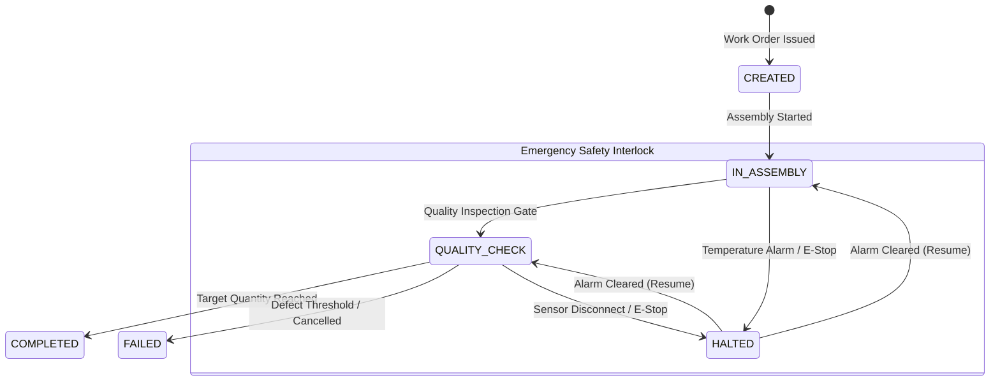

# Modular Smart Factory / Manufacturing Execution System (MES) Platform

A scalable, event-driven, Industry 4.0 **Smart Factory & Manufacturing Execution System (MES)** core backend platform. Built with **Spring Boot 3 (Java 21)**, **Apache Kafka**, **PostgreSQL**, **Redis**, and **WebSockets**, designed from the ground up for modularity and adaptable to diverse industrial domains (Automotive, Electronics, Food & Beverage, Pharmaceutical, and General Manufacturing).

---

## 🏗️ Architecture & Technology Stack

| Layer / Component | Technology | Description |
| :--- | :--- | :--- |
| **Backend Core** | **Spring Boot 3.3.4 (Java 21)** | Domain-Driven Design (DDD), Clean Architecture, REST APIs |
| **Relational Database** | **PostgreSQL 16** | Persistent transactional store for work orders, item audit logs, and stations |
| **Event Streaming & Telemetry** | **Apache Kafka 3.7 (KRaft)** | Real-time sensor telemetry, station event publishing, decoupled streaming |
| **In-Memory Cache / Hot Data** | **Redis 7** | Sub-millisecond station status lookups, real-time machine workloads |
| **Real-Time Communication** | **WebSockets (STOMP)** | Live operator dashboard updates, instant anomaly & emergency halt alerts |
| **Containerization** | **Docker & Docker Compose** | One-command local orchestration of PostgreSQL, Kafka, and Redis |
| **API Documentation** | **Swagger / OpenAPI 3** | Interactive REST API exploration (`/swagger-ui.html`) |
| **Testing** | **JUnit 5 & AssertJ** | Robust domain unit tests, state machine and business rule verification |

---

## 🏭 Production Line Stations (Domain Model)

1. **Raw Material Acceptance (`RAW_MATERIAL_ACCEPTANCE`):**
   - Ingests incoming industrial materials, validates batch numbers (`batchNumber`), supplier certificates, quantities, units, and initial quality clearance.
2. **Assembly & Welding (`ASSEMBLY`):**
   - Physical assembly and joinery stage. Features robotic arm integration (`activeRobotsCount`) and real-time operational status tracking.
3. **Coating & Painting (`PAINTING`):**
   - Surface finish, industrial ovens, and curing chambers. Monitored with critical temperature thresholds (`temperatureThreshold`) for anomaly prevention.
4. **Quality Inspection (`QUALITY_CHECK`):**
   - Stringent tolerance and defect inspection. Items pass to packaging (`PASSED`), undergo rework cycles (`REWORK`, up to 2 attempts), or are scrapped (`FAILED`).
5. **Packaging & Dispatch (`PACKAGING`):**
   - High-throughput packaging, barcode assignment, and dispatch staging (`PACKED`).

---

## 📋 State Machines & Lifecycles

### 1. Work Order Lifecycle (`WorkOrder`)

### 2. Production Item Lifecycle (`ProductionItem`)

- **Standard Progression:**  
  `CREATED` ➔ `IN_PROGRESS` (Station Entry) ➔ `PASSED` (Station Exit)
- **Quality Inspection Decision Gate:**
  - **Passed:** Advances to `PACKAGING` ➔ `PACKED` (Order completion incremented).
  - **Defect Identified:** Routes to `REWORK` (re-enters Assembly or Painting, max 2 iterations).
  - **Limit Exceeded:** Automatic escalation to `FAILED` (scrap disposition).

---

## 🛡️ Business Rules & Safety Interlocks

- **Pipeline Sequence Enforcement:** Discrete items cannot skip stations (e.g., jumping from Assembly directly to Packaging without Painting and Quality Inspection).
- **Quality Gate Invariant:** An item is strictly barred from entry into Packaging without an explicit `PASSED` verification at Quality Check.
- **Rework Boundary:** Configurable limit (`DEFAULT_MAX_REWORK_LIMIT = 2`). Exceeding this boundary triggers `MaxReworkExceededException` and transitions the unit to `FAILED`.
- **Emergency Stop Safety Interlock:** When a Work Order or Station is placed into `HALTED` status, all item progression is immediately locked until explicitly authorized via `resume()`.

---

## 🌐 Multi-Industry Domain Customization

The platform core is built with polymorphic station strategies and an industry abstraction (`IndustryType`):

- **Automotive (`AUTOMOTIVE`):** High-density robotic welding, oven cure temperatures up to 200°C.
- **Electronics (`ELECTRONICS`):** Cleanroom ESD monitoring, reflow soldering profiles, automated optical inspection (AOI).
- **Food & Beverage (`FOOD_AND_BEVERAGE`):** Cold-chain thermal telemetry, pasteurization thresholds, HACCP compliance.
- **Pharmaceutical (`PHARMACEUTICAL`):** Sterilization validation, GMP cleanroom pressure differentials, batch genealogy.
- **General Manufacturing (`GENERAL_MANUFACTURING`):** Standard discrete manufacturing pipeline.

---

