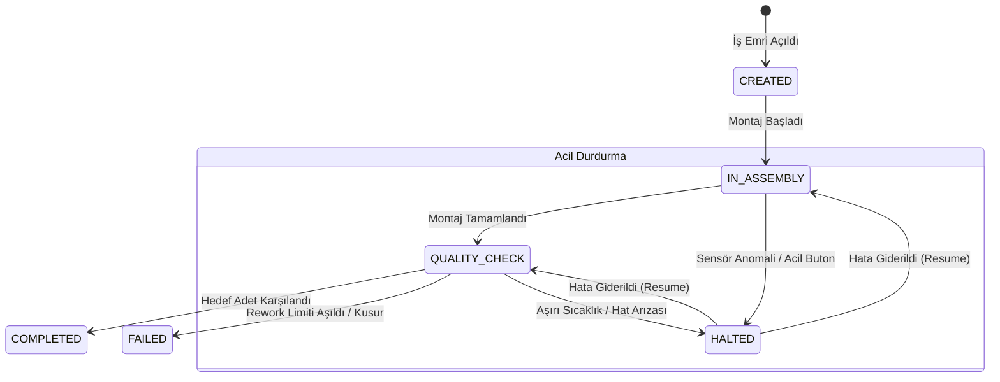

# Modular Smart Factory / Manufacturing Execution System (MES) Core Platform

Endüstri 4.0 ve akıllı üretim hatları için geliştirilmiş, yüksek ölçeklenebilir, olay güdümlü (Event-Driven) ve çoklu endüstri alanlarına uyarlanabilir fabrika otomasyon çekirdek backend platformu.

---

## 🏗️ Mimari ve Teknoloji Yığını

| Katman / Bileşen | Teknoloji / Araç | Açıklama |
| :--- | :--- | :--- |
| **Backend Çekirdeği** | **Spring Boot 3.3.4 (Java 21)** | Domain Driven Design (DDD), Clean Architecture, REST API |
| **Kalıcı Veri Tabanı** | **PostgreSQL 16** | İlişkisel veri, iş emirleri, parça geçmişi ve denetim kayıtları |
| **Event & Telemetri Akışı** | **Apache Kafka 3.7 (KRaft)** | Sensör telemetrisi, istasyon olayları, asenkron hat haberleşmesi |
| **Sıcak Veri & Cache** | **Redis 7** | Anlık hat durumu, makine yükleri, hızlı istasyon sorgulama |
| **Gerçek Zamanlı İletişim**| **WebSockets (STOMP)** | Operatör ekranları & dashboard için canlı bildirimler ve anomali uyarıları |
| **Konteynerizasyon** | **Docker & Docker Compose** | Tek komutla PostgreSQL, Kafka ve Redis altyapı kurulumu |
| **API Dokümantasyonu** | **Swagger / OpenAPI 3** | Etkileşimli REST API dokümantasyonu (`/swagger-ui.html`) |

---

## 🏭 Üretim Hattı İstasyonları (Domain Model)

1. **Hammadde Kabul (`RAW_MATERIAL_ACCEPTANCE`):**
   - Fabrikaya gelen hammaddelerin parti numarası (batch), miktar, birim ve kalite onayı ile kayıt altına alınması.
2. **Kaynak / Montaj (`ASSEMBLY`):**
   - Parçaların robot kolları (`activeRobotsCount`) ile birleştirilmesi ve fiziksel montajı.
3. **Boyama (`PAINTING`):**
   - Yüzey kaplama, fırınlama ve kurutma üniteleri. Sıcaklık eşik değerleri (`temperatureThreshold`) ile anomali takibi.
4. **Kalite Testi (`QUALITY_CHECK`):**
   - Tolerans ve standart kontrolleri. Geçen ürünler `PASSED`, kusurlu ürünler `REWORK` (maksimum 2 hak) veya `FAILED` (hurda).
5. **Paketleme (`PACKAGING`):**
   - Kalite testinden başarıyla geçen nihai ürünlerin mühürlenip sevkiyata hazırlanması (`PACKED`).

---

## 📋 İş Emri (Work Order) ve Kalem (Production Item) Durum Çevrimi



### 🧩 Üretim Kalemi (Production Item) Yaşam Döngüsü:
- `CREATED` ➔ `IN_PROGRESS` (İstasyonda işleniyor) ➔ `PASSED` (İstasyon tamamlandı)
- Kalite İstasyonu Testi:
  - Onay ➔ `PACKAGING` ➔ `PACKED` (Tamamlandı)
  - Kusur ➔ `REWORK` (Max 2 deneme, montaj/boyamaya dönüş) ➔ Sınır aşılırsa `FAILED`

---

## 🌐 Çoklu Endüstri Uyarlanabilirliği (Modular Industry Extensibility)

Platform, otomotiv dışındaki sektörlere kolayca uyarlanabilecek şekilde genişletilebilir:
- **`IndustryType.AUTOMOTIVE`**: Yüksek robotik montaj, boya fırını sıcaklık toleransı.
- **`IndustryType.ELECTRONICS`**: ESD (statik elektrik) koruması, mikroskopik lehim muayenesi.
- **`IndustryType.FOOD_AND_BEVERAGE`**: Soğuk zincir sensörleri, pastörizasyon fırınları, hijyen kontrolü.
- **`IndustryType.PHARMACEUTICAL`**: Sterilizasyon eşikleri, GMP parti takibi.

---

## 🚀 Hızlı Başlangıç

### 1. Altyapıyı Başlatın (Docker Compose)
```bash
docker compose up -d
```
*PostgreSQL (`5432`), Redis (`6379`) ve Apache Kafka (`9092`) servisleri ayağa kalkar.*

### 2. Projeyi Derleyin ve Test Edin
```bash
mvn clean test
```

### 3. Uygulamayı Çalıştırın
```bash
mvn spring-boot:run
```
Swagger UI Arayüzü: `http://localhost:8080/swagger-ui.html`
